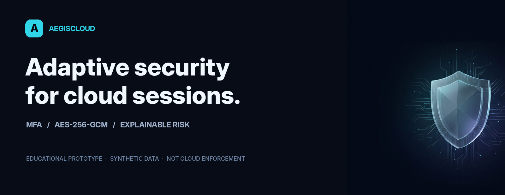
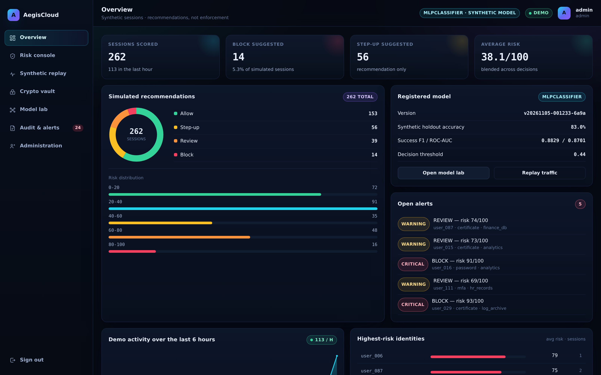

<div align="center">



**A hands-on security prototype combining identity, encryption and explainable synthetic risk scoring.**

[Explore the presentation](docs/AegisCloud_Presentation.pptx) · [Project guide](docs/PROJECT_GUIDE.md) · [Demo questions](docs/VIVA_QA.md)

</div>

> **Educational prototype, not a production security system.** Risk actions are
> recommendations on synthetic sessions; they do not enforce AWS, Azure or GCP
> access. The model predicts synthetic success/failure, not real attack labels.



## What you can explore

| Area | Implemented demonstration |
|---|---|
| Identity & access | Password registration, scrypt hashing, login lockout, TOTP and recovery-code APIs, trusted-device records, role checks and revocable sessions. |
| Session risk | ML success probability + rule points, bounded 0–100 risk, per-factor explanation, four suggested actions and synthetic scenario presets. |
| Encrypted vault | Per-file AES-256-GCM data keys wrapped by a local master key; tamper test, local key rotation and limited-use expiring share links. |
| Threshold sharing | Standalone Shamir k-of-n demo over GF(2⁸) for a supplied string—not a vault-key recovery system. |
| ML & monitoring | Four validation candidates, chronological holdout, threshold tuning, a model registry, manual retraining and PSI comparison of synthetic CSVs. |
| Operations | Synthetic replay, stored feedback, demo review queue, alerts, hash-linked audit records and an integrity checker. |
| Engineering | Flask/SQLite, responsive web console, Docker demo, 26 isolated tests, screenshots and an exploratory sequence-model notebook. |

## Quick start

Python 3.10–3.13 recommended. Run locally in a virtual environment:

```bash
git clone https://github.com/joyboyzz/AegisCloud.git
cd AegisCloud
python -m venv .venv
source .venv/bin/activate       # Windows: .venv\Scripts\activate
python -m pip install -r requirements.txt
python scripts/bootstrap.py     # register bundled synthetic model and seed demo
python run.py                   # http://127.0.0.1:5000
```

| Demo user | Demo password | Second factor |
|---|---|---|
| `admin` | `Admin@Aegis2026` | OTP displayed on screen in demo mode |
| `analyst` | `Analyst@Aegis2026` | TOTP; run `python scripts/show_demo_totp.py` locally |
| `demo_user` | `User@Aegis2026` | OTP displayed on screen in demo mode |

> The demo credentials and development secret are deliberately public, not
> secure defaults. `AEGIS_DEMO=0` has no SMTP provider, so email-OTP accounts
> cannot sign in until a delivery provider is implemented. Do not expose this
> development server to an untrusted network.

The generated SQLite database, vault blobs and master key live under `instance/`
and must be kept private and backed up together. To run a separate fresh demo
without altering another database or vault, set `AEGIS_INSTANCE_DIR` to a new
folder **for both bootstrap and run**:

```bash
export AEGIS_INSTANCE_DIR="$PWD/instance/fresh-demo"
python scripts/bootstrap.py
python run.py
```

The default response blocks cross-origin framing. For a trusted embedded demo
preview only, `AEGIS_ALLOW_EMBED=1` opts into cross-site framing and Secure,
partitioned cookies. An HTTPS proxy is required. Do not use this in production.

## Synthetic experiment

The included corpus contains **9,000 generated sessions**. The chronological
split is **6,300 train / 1,350 validation / 1,350 holdout**. User baselines,
category vocabulary and scaling are fitted only on training data. Class 1 is
**success** and class 0 is **failure**. A separate 2,500-row corpus is replayed.

Candidates compared on the **validation block** at a 0.50 threshold:

| Candidate | Accuracy | Success F1 | ROC-AUC |
|---|---:|---:|---:|
| MLPClassifier **(selected)** | 0.8007 | 0.8520 | 0.8661 |
| RandomForest | 0.7933 | 0.8446 | 0.8524 |
| HistGradientBoosting | 0.7874 | 0.8436 | 0.8496 |
| LogisticRegression | 0.7867 | 0.8284 | 0.8738 |

The selected **MLPClassifier** has its threshold tuned on validation and is
then evaluated on the later **synthetic holdout**:

| Test measure | Value |
|---|---:|
| Success-probability threshold | 0.44 |
| Accuracy | 0.8304 |
| Success precision / recall / F1 | 0.8387 / 0.9320 / 0.8829 |
| Failure recall (TN / (TN + FP)) | 0.6085 |
| ROC-AUC / Brier score | 0.8701 / 0.1292 |
| Confusion [TN, FP; FN, TP] | [258, 166; 63, 863] |

These are synthetic **outcome** metrics, not attack-detection rates. A Brier
score alone does not establish probability calibration. The included Colab
LSTM/1D-CNN notebook is prepared but **training has not been run**; it does not
support a deep-model winner claim.

## Run the tests

```bash
python -m pytest tests/ -q
```

The 26-test suite uses a temporary SQLite database and vault. It checks vault
integrity, GF arithmetic, sessions, TOTP vectors, concurrent sharing and audit
writes, training-only baselines, risk explanations and instance isolation.

## Boundaries and responsible use

- Suggested allow / step-up / review / block are not provider enforcement.
  The informational login risk score does not enforce review or block.
- TOTP enrollment and recovery are API flows; there is no enrollment screen.
- Local key rotation is a demo and is not a crash-safe managed-KMS workflow.
- Fewer than k demo shares may produce garbage instead of a clear error.
- Feedback is recorded, but is not used by retraining; PSI compares static
  synthetic CSVs, not live cloud telemetry. Retraining is manual.
- The review queue does not enforce independent separation of duties.
- An attacker controlling the whole audit chain could recompute it: the local
  hash chain is not non-repudiation or an externally anchored audit log.
- For real deployments use secure OTP delivery, HTTPS, managed secrets and keys,
  real telemetry, access-control integration, independent testing and review.

## Rebuild the visual assets

```bash
python -m pip install -r requirements-dev.txt
python scripts/make_deck.py
python scripts/make_report.py
python scripts/make_media.py
```

To retake screenshots, install Chromium with `python -m playwright install
chromium`, start a **separate, fictional demo instance**, and run
`python scripts/shoot.py`. The script logs in, replays sessions and performs a
vault tamper demonstration; do not point it at personal or production data.
Your operating system may require additional Playwright browser libraries.

## Repository map

```text
app/             Flask API, identity, vault, risk, ML, drift and web UI
artifacts/       synthetic reference/replay CSVs and trusted champion model
screenshots/     captures from a fictional, isolated demo instance
notebooks/       unexecuted LSTM / 1D-CNN experiment
scripts/         bootstrap and repeatable document/media builders
tests/           isolated pytest suite
docs/            presentation, technical overview, project and viva guides
media/           LinkedIn-ready project media and artwork
instance/        local private data, generated at runtime; not committed
```

`requirements-dev.txt` adds document and notebook generation dependencies.
The Dockerfile is provided only for local demonstration.

**Provenance:** AegisCloud reworks material from an earlier academic prototype;
this repository documents the current implementation. Presented by Praveen Sudireddy.
